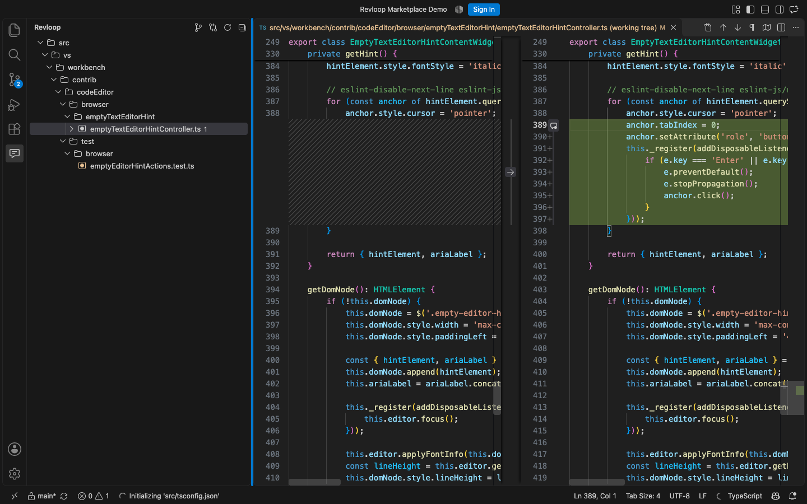
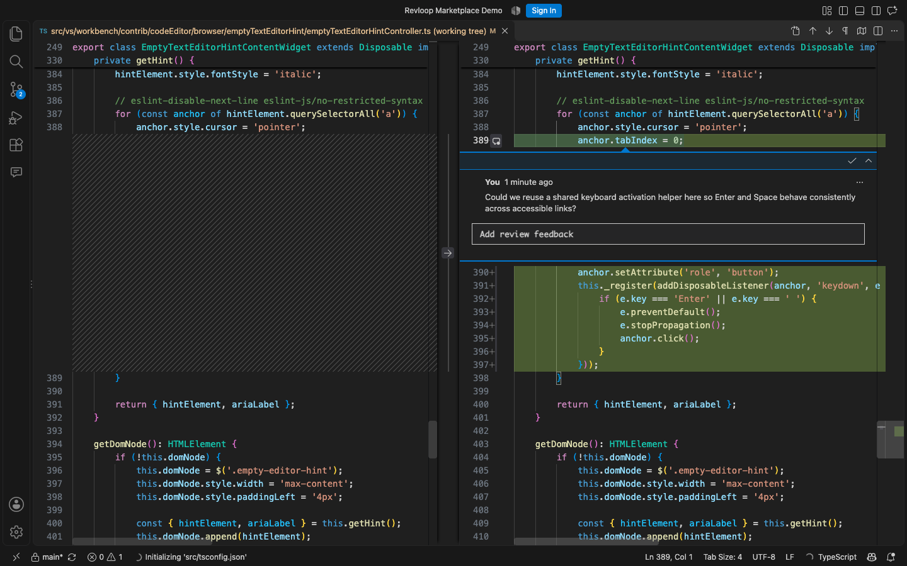

# Revloop

Revloop lets you review local coding-agent changes with persistent inline
threads in native VS Code diffs.

Use it to inspect a working tree or compare a branch with its base, attach
feedback directly to modified lines, and keep each conversation anchored as the
code changes.

## Features

- Review uncommitted working-tree changes against the current `HEAD`.
- Review a branch against the merge base of a selected base branch.
- Navigate changed files and threads from the Revloop activity-bar view.
- Add, edit, reply to, resolve, and reopen inline review threads.
- Preserve branch-scoped review state across VS Code reloads.
- Remap anchors as files change while retaining outdated threads and their
  original context.
- Share the same review state across linked Git worktrees.
- Let compatible coding agents read feedback and append replies through the
  optional Revloop agent plugin.

Only you can resolve or reopen a thread. Agent replies are read-only in VS Code.

## Requirements

- VS Code 1.101 or later.
- A trusted, local Git workspace on a named branch.
- At least one commit in the repository.

Detached `HEAD`, unborn repositories, virtual workspaces, and untrusted
workspaces are not supported.

## Installation

Install **Revloop** from the VS Code Marketplace or run:

```bash
code --install-extension bensiegel.revloop
```

If you installed a pre-Marketplace local build, remove its old extension ID
before installing this release:

```bash
code --uninstall-extension revloop.revloop
code --install-extension bensiegel.revloop
```

Reload VS Code after migrating.

Open the **Revloop** view from the activity bar after installation.

## Quick start

1. Select **Review Working Tree** to review local changes, or **Review Branch
   Against Base** to compare the current branch with another branch.
2. Select a changed file in the Revloop view to open its native VS Code diff.
3. Select modified lines and run **Revloop: Add Review Thread** from the editor
   context menu.
4. Add feedback using VS Code's comment controls.
5. Resolve the thread when the feedback has been addressed, or leave it open
   for further work.

Revloop preserves unresolved, resolved, and outdated threads when you reload VS
Code or reopen the repository.

## Review changed files and threads

The Revloop view groups changed files by directory and shows each file's open
thread count.



## Keep feedback anchored to the diff

Threads appear directly in VS Code's native diff editor and remain attached as
the implementation changes.



## Coding-agent integration

The extension works independently for manual review. To let a compatible coding
agent read comments and append replies, install the companion Agent Plugins
bundle.

With GitHub Copilot CLI:

```bash
copilot plugin marketplace add bensiegel100/revloop
copilot plugin install revloop@revloop
```

If `revloop` was previously registered from a local checkout, replace that
registration first:

```bash
copilot plugin marketplace remove revloop --force
copilot plugin marketplace add bensiegel100/revloop
copilot plugin install revloop@revloop
```

Verify the public installation with:

```bash
copilot plugin marketplace browse revloop
copilot plugin list
```

Restart Copilot CLI after the first installation, then run:

```text
/review-comments
```

The plugin requires Node.js 20 or later on `PATH`. It exposes only
`read_comments` and `reply_to_comment`; agents cannot resolve, reopen, move, or
delete threads.

## Storage and privacy

Revloop stores branch-scoped review state inside the repository's Git common
directory:

```text
<git-common-dir>/revloop/branches/
```

This location lets VS Code, linked worktrees, and local agent processes share
the same review state without a background service.

The Revloop extension and bundled MCP server do not collect telemetry, upload
source code, or make network requests. Your editor, coding agent, and installed
extensions may have their own data-handling policies.

## Limitations

- Threads can be created only on modified lines in the active review.
- Reviews are tied to the current named branch.
- A thread becomes outdated when its original anchor can no longer be mapped;
  Revloop preserves it instead of deleting it.
- The companion agent plugin must be installed separately from the VS Code
  extension.

## Support

Report bugs and request features in the
[Revloop issue tracker](https://github.com/bensiegel100/revloop/issues).

Revloop is available under the
[MIT License](https://github.com/bensiegel100/revloop/blob/main/LICENSE.md).
